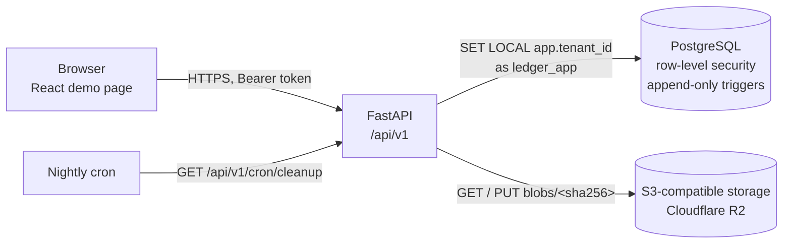

# Architecture

Clinical Ledger is one FastAPI application, one PostgreSQL database and one S3-compatible
bucket. The demo page is a React app served by the same deployment.



## Request path

1. The page signs in with `POST /api/v1/auth/demo` and a role. The first sign-in creates a demo
   tenant: a private copy of 75 seed records, their versions and a fresh hash chain, written in
   one transaction. The response is a signed token (HS256) carrying the actor, role and tenant,
   expiring with the tenant.
2. Every later request sends the token. A dependency checks it, checks the tenant still exists,
   and checks the role has the permission the route needs.
3. The route opens a transaction and sets `app.tenant_id` for that transaction only. Row-level
   security policies on every tenant table compare each row's `tenant_id` to that setting.

The application connects as `ledger_app`, a login created by the migration. It can `SELECT` and
`INSERT` ledger tables, update only `record_heads`, and run two `SECURITY DEFINER` functions.
It cannot disable row-level security or the append-only triggers.

## Data model

| Table | Holds | Changes |
| --- | --- | --- |
| `tenants` | One row per demo or standard tenant, with expiry | Inserted; deleted by cleanup |
| `actors` | Demo clinician, auditor and admin | Inserted at seed time |
| `blobs` | Content hash, size, media type, storage key | Insert only, shared across tenants |
| `records` | Record id, kind, subject | Insert only |
| `versions` | Record id, version number, content hash, time, note | Insert only |
| `record_heads` | Latest version number and hash per record | Updated on each new version |
| `events` | The journal: one hash-chained entry per action | Insert only |
| `checkpoints` | Entry number and hash every 1,000 entries | Insert only |
| `blob_overrides` | A tenant's tampered copy of a blob (demo only) | Inserted by the tamper function |

## The hash chain

Each journal entry stores `prev_hash` and `event_hash`, where

```
event_hash = sha256(prev_hash || canonical_json(tenant, seq, type, record, version,
                                                actor, role, occurred_at, payload))
```

Canonical JSON sorts keys, rejects floats, and writes timestamps in UTC with microseconds, so a
row read back from PostgreSQL hashes to the same value it was written with. The first entry's
`prev_hash` is 64 zeros. Appends take a per-tenant transaction advisory lock, so two writers
cannot both extend the chain from the same entry.

Verification walks the entries in order with a server-side cursor, recomputing each hash, then
fetches every document the tenant references and rehashes it. It reports the first entry that
fails (`hash_mismatch` or `broken_link`, with the stored and recomputed hash) or the first
document whose bytes no longer match (`blob_mismatch`). Starting from the latest checkpoint
checks only the entries after it.

## Tampering in the demo

The demo needs to break things without giving the application rights to break things. Two
`SECURITY DEFINER` functions own that:

- `demo_tamper_event(tenant, seq)` edits one entry's payload in the caller's own tenant. It
  refuses any tenant other than the one set for the transaction.
- Tampering with a file writes altered bytes under `overrides/<tenant>/<hash>` and records a
  `blob_overrides` row, so only that tenant's reads see the altered file.

## Storage

Documents are stored once under `blobs/<sha256>`, whoever writes them. Seed documents are
shared by every demo tenant. Reads fetch the object and check its hash before returning it; a
mismatch returns `409` with a problem response instead of the content.

## Hosting

The deployed demo uses free tiers, confirmed against each provider's documentation in
November 2026:

| Part | Service | Free tier used |
| --- | --- | --- |
| API and page | Vercel Hobby, Python runtime (FastAPI detected from `app.py`) | Functions up to 300 s, daily cron |
| Database | Neon via the Vercel marketplace, pooled connection | 1 GB storage, 100 compute hours a month, sleeps after 5 idle minutes |
| Documents | Cloudflare R2 | 10 GB, 1 million writes and 10 million reads a month, no egress fees |

Vercel builds the page with `npm run build` and bundles it with the function, which serves it
alongside the API. The nightly cron calls `/api/v1/cron/cleanup` with a shared secret to delete
expired demo tenants. The app reads its own connection from `LEDGER_DATABASE_URL`, because the
Neon integration manages `DATABASE_URL` for the owner login.

## Errors

Every error is an RFC 9457 problem response (`application/problem+json`) with a stable `type`
URL. Database or storage outages return `503`, which the page shows as a retry state.
